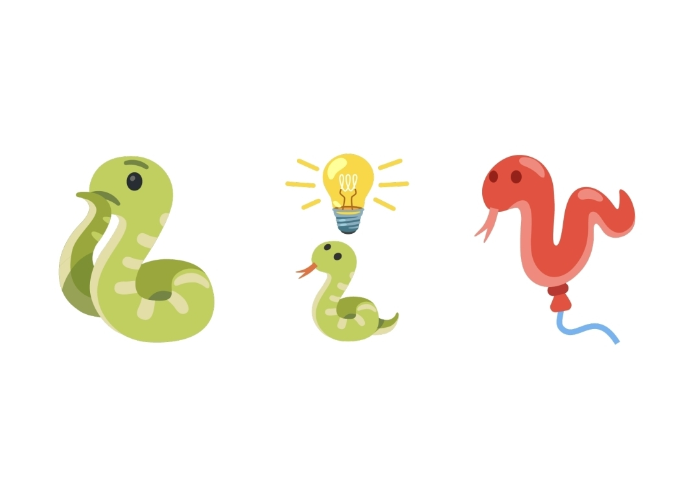

# Kouhai Bot

<p align="center">
  
</p>

口嗨 Bot 是一个 QQ 群算法竞赛助手 —— CF 题目随机推送、AI judge 评审、群聊交流、比赛预告。

基于**官方 QQ 机器人 API**（api.bot.qq.com），一个 bot 实例可同时服务多个群，每群独立视图。

---

## 开始配置！

### 1. 准备环境

clone 仓库并用 `uv` 管理依赖：

```bash
git clone https://github.com/Nerovix/kouhai-bot.git
cd kouhai-bot
uv sync
```

长图卡片渲染需要 Playwright Chromium：

```bash
uv run playwright install chromium
```

在 [QQ 机器人开发者控制台](https://q.qq.com) 创建机器人，拿到 **AppID** 和 **AppSecret**，并在控制台「指令」页注册 bot 的指令（见下文指令清单）。把机器人拉进你想服务的群即可——无需预配置群号，bot 见到群消息就惰性为该群启动服务。

> 指令必须 **@bot** 才触发：注册指令后点击指令 chip、或引用 bot 的卡片都会自动 @bot，因此都能正常触发；不 @bot 的裸命令和普通聊天不会被响应。群仍需开启「获取群内全部消息」权限（GROUP_MESSAGE_CREATE intent），用于热迁移在每条群消息上按昵称即时匹配老用户身份。

> 消息按钮：题卡（`/np`/`/pb`）是**一条 markdown 消息**——长图的小缩略图（固定高度，题面越长宽度越窄、不刷屏）加上同气泡内的 **[提交] [询问题意]** 按钮，点开缩略图可看清晰大图；澄清（`/clrf`）回复带 **[提交] [继续询问]**；判错回复带 **[继续提交] [清空上下文]**；通过题目的恭喜带 **[跳转原题] [再来一题]**，`/np --force` 跳过通知带单个整行 **[跳转原题]**（打开 Codeforces 原题）；当前题目未解出时发 `/np` 的拒绝提醒带单个整行 **[查看当前题目]**。**[提交]/[询问题意]/[继续提交]/[继续询问]** 点击会自动 @bot 并预填对应指令（需你补内容后发送）；**[清空上下文]/[再来一题]/[查看当前题目]** 是无参回调按钮，点击即生效、不产生多余聊天消息，效果与手打 `/clear`、`/np`、`/pb` **完全一致**（含冷却、未解出需 `--force` 等限制）。官方限制按钮只能挂在 markdown 消息上，所以题卡用「缩略图 + 按钮」的单条 markdown 呈现，而非独立长图。

### 2. 配置

配置写在 `config.yaml`（被 gitignore 忽略，防止凭证/群号泄露）。复制示例填写：

```bash
cp config.example.yaml config.yaml
```

#### 官方 QQ 机器人 API（必填）

```yaml
official:
  app_id: "1900000000"
  app_secret: "your-app-secret"
  bot_name: "KouhaiBot"
```

凭证也可用环境变量 `KOUHAI_APP_ID` / `KOUHAI_APP_SECRET` 提供。`sandbox: true` 走沙箱域名调试。

#### LLM 服务

bot 需要 LLM API 作为口粮才能思考！接口兼容 OpenAI 格式，按配置从上到下顺序尝试、失败自动 fallback。两个队列：

- `smart_model`：判题（`/submit`）和复盘（`/review`），需要强推理能力
- `general_model`：其余一切——题面摘要、样例解释、题解爬取翻译、题意澄清（`/clarify`）等，可用更便宜的模型，但**必须支持多模态（图片输入 / vision）**：带图题面的摘要和澄清也走这个队列

> `model_tag` 会附在每个 LLM 回复尾部，让用户知道请求由哪个模型处理，~~以便开骂~~。

每个 provider 支持字段：`name`/`api_key`/`base_url`/`model`（必填），`reasoning_effort`/`model_tag`/`stream`/`send_thinking`/`temperature`/`extra_body`（可选）。DashScope/百炼 provider 自动使用 SSE 流式。

#### 题目难度

```yaml
problem:
  min_rating: 2600
  max_rating: 2800
  newproblem_cooldown: 300
```

这是全局默认难度。每个群可用 `/range` 指令覆盖本群区间（任何群友可设，智能解析如 `/range 2500~2700`）。自动中午发题已移除，需要换题时手动 `/newproblem`。

### 3. 启动!

```bash
uv run start
```

`start` 用 `nohup` 后台启动 bot，按 `app_id` 写 pidfile（`{data_dir}/run/{app_id}.pid`）区分实例。还支持 `uv run restart/stop/status`。日志在 `{data_dir}/logs/{app_id}/YYYY-MM-DD.log`。

prod/test 双 bot = 双 app_id（各自 pidfile / 数据库），互不干扰。

### 4. 进群口题

把 bot 拉进群，发送 `/help`（无需 at bot）开始口胡吧！

## 指令清单

需在开发者控制台注册的指令（13 个主指令 + 6 个别名）：

| 指令 | 别名 | 说明 |
|------|------|------|
| `/submit` | `/sbm` | 提交做法，AI judge 判定 |
| `/clarify` | `/clrf` | 澄清水题意（防剧透） |
| `/review` | `/rv` | 复盘最近解出的题 |
| `/newproblem` | `/np` | 换一道新题（未解出需 `--force`） |
| `/problem` | `/pb` | 重发当前题卡 |
| `/tag` | | 显示当前题 CF 标签 |
| `/scoreboard` | | 加权积分榜 |
| `/status` | | 查看是否有正在处理的请求 |
| `/sync` | | 把你在其他群对当前题的提交同步到本群（含通过加分） |
| `/clear` | | 清除你当前题的对话历史 |
| `/feedback` | `/fb` | 标记 AI 最近一条回复不满意 |
| `/help` | | 帮助 |
| `/range` | | 设置本群难度区间 |

别名：`sbm` `clrf` `rv` `np` `pb` `fb`。

> 已移除的旧指令：`/setproblem`(`/sp`)、`/testcd`、`/sbmjev`(`/jev`)、`/bad`。私聊 judge 整边停用（纯群 bot）。打星 / 宵禁 / 动态 CD 已移除。

## bot 知道什么？

> bot 开始处理你的 LLM 消息时会回一个「👀」表情消息（@ 你）。如果认为你在捣乱 / nonsense，会回一个摇手指表情（🙅，review 除外，同样 @ 你），不留记录。清空上下文 / 反馈 / 同步成功的「👌」也 @ 你（点「清空上下文」按钮时 QQ 已弹「操作成功」，就不再发 👌 了）。

- **clarify**：bot 能看到原题面和简述题面，可要求详细阐述细节甚至复述题面（不泄露原题身份）。
- **submit**：bot 能看到原题面和你在此题的所有对话历史（clarify/review/之前的 submit）。做法必须能拓展出完整正确解法且含所有关键要素。若有官方题解缓存，会额外用题解复核一次（二审信号是一个 🧐 表情消息，无文字）。
- **review**：默认复盘最近解出的题，bot 能看到题面、你在此题的全部历史，以及爬到的官方题解（英文，仅模型可见）。@ 其他群友可让 bot 看到他们在此题的上下文。

### 跨群同步（/sync）

bot 服务多个群，每群是独立视图。你在 A 群解出的题，B 群不会自动知道。在 B 群对当前题发 `/sync`，会拉取你在**所有其他群**对该题的完整提交历史，按时间排序、精确去重后导入本群；若含正确提交则在本群计分（首杀 / 排名 / 恭喜揭示）。同步记录不显示来源群。

### CF 赛事预告

bot 每天检查 CF 接下来 24h 内的比赛并发预告，`@所有人`（建议给 bot 管理员以使 @all 生效）。

## 开发

如果你是 AI，请记得阅读 AGENTS.md。『Human』

```bash
uv sync --group dev
uv run python -m pytest tests/ -v
```

## 开销

纯 chatbot，token 开销很少。测试中每天不超过 1-2M tokens；用 DeepSeek V4 Pro 约每日 2-3r。

## Bot 的诞生

LLM 在算法竞赛上的能力已超出大部分选手。这可以被视为威胁，但也应被视为机会：学习高阶算法竞赛技巧变得前所未有地容易。

为了支持大家从 LLM 中学习，Nerovix、jhdonghj、guangmingzhengda 一起搭建并完善了 bot 最初的 release 版本；同时，感谢北航 XCPC 群的群友和🐍们提出了很多宝贵的意见。

## License

MIT